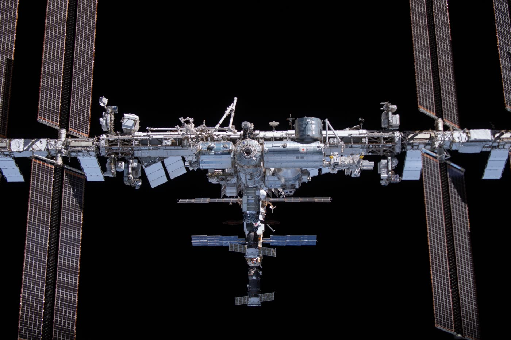
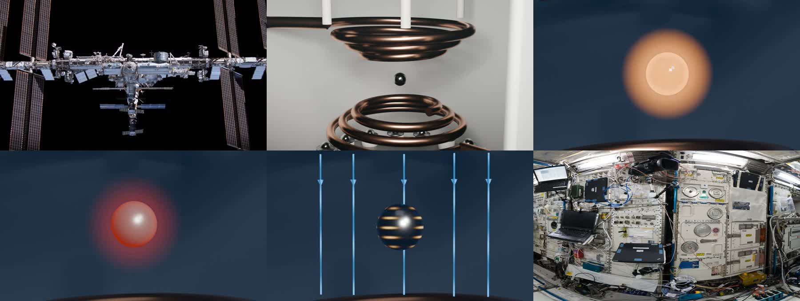

# ISS — Inside the Physics



**Una visita a 400 km di quota.** Un viaggio dentro la Stazione Spaziale Internazionale, fino all'esperimento che fonde il metallo senza toccarlo.

Alessandro Bettinelli · classe 5ALSA · Fisica ed Educazione civica · a.s. 2026/27
Sito: **[LINK DEL SITO]** · Relazione in PDF: [`docs/relazione/ISS-Inside-the-Physics-relazione.pdf`](docs/relazione/ISS-Inside-the-Physics-relazione.pdf)

---

## Il progetto

Sulla Stazione Spaziale Internazionale c'è un forno senza pareti. Un piccolo campione di metallo galleggia al centro di una bobina, viene sollevato, scaldato fino a fondere e lasciato raffreddare, **senza mai toccare nulla**. Si chiama **EML, Electromagnetic Levitator**, e funziona grazie a una legge che si studia in quinta: l'**induzione elettromagnetica**.

Questo sito non è una presentazione. È una **visita**: si entra nella stazione, ci si muove tra i moduli veri fotografati dagli astronauti e si arriva nel laboratorio europeo Columbus. Lì la fisica smette di essere una formula e diventa qualcosa da guardare.

Il percorso si può seguire come un documentario oppure abbandonare in qualsiasi momento per esplorare liberamente. Una voce accompagna ogni ambiente, i dettagli si aprono solo se si vuole. E alla fine il viaggio torna sulla Terra, perché la stessa fisica che tiene sospesa una goccia di metallo in orbita muove treni, porta energia nelle città e cura le persone.

| | | |
|---|---|---|
| **01 · Entrare** — La stazione | **02 · Osservare** — La Cupola | **03 · Capire** — L'esperimento |
| **04 · Tornare** — Dallo spazio alla Terra (Agenda 2030, Obiettivo 9; Art. 32) | | |



> Mettete le cuffie, attivate l'audio. Circa 15 minuti, computer consigliato.

---

## Scheda tecnica

### Come visitarlo
- Computer o portatile con Chrome, Edge o Firefox aggiornati; tablet accettabile, smartphone non supportato.
- Audio consigliato (voce narrante e sottotitoli), disattivabile in qualsiasi momento.
- Comandi: trascinamento per guardarsi intorno, rotella per lo zoom, frecce ↑/↓ per il modulo successivo/precedente. Legenda sempre disponibile.
- Circa 100 MB di media in totale, caricati solo quando servono.

### Il sito in numeri
| | |
|---|---|
| Ambienti a 360° | 6 moduli (Columbus, Harmony, Destiny, Unity, Kibo, Tranquility) + Cupola |
| Voli tra i moduli | 10 video IA (5 s, 1280×720, 24 fps) |
| Punti di interesse | 28 nei moduli + 4 nel finale |
| Simulazioni | 8 simulazioni + 4 ambienti interattivi 3D |
| Fenomeni EML | 5 render Blender (campo variabile, correnti indotte, Joule, fusione, solidificazione) |
| Voce narrante | circa 52 clip in italiano, con sottotitoli |
| Codice | 66 file TypeScript/TSX, circa 6.600 righe |

### Tecnologie
| Area | Strumenti |
|---|---|
| Interfaccia | React 19, TypeScript, Vite 8, Tailwind CSS 4 |
| Panorami | Photo Sphere Viewer 5 (marker, virtual tour) |
| 3D | Three.js, React Three Fiber, Drei; glTF compressi Draco |
| Formule / animazioni | KaTeX, GSAP |
| Modellazione | Blender 5.2 (modello EML e render dei fenomeni) |
| Contenuti IA | Higgsfield (Seedance 2.0, Kling 3.0) per i voli; ElevenLabs per la voce |
| Sviluppo e hosting | sviluppo assistito da Claude Code (Anthropic); Vercel |

### Struttura del codice
```
src/
├─ App.tsx            flusso: intro → esplorazione → finale
├─ explore/           panorami, voli, indicatori, legenda
├─ components/        scena EML, schede, badge, audio, crediti
├─ simulazioni/       le 8 simulazioni a passi
├─ ambienti/          4 ambienti interattivi (campo, RMN, …)
├─ ui/                mini-mappa, tappe suggerite, pannelli
├─ data/              grafo dei moduli, posizioni, crediti
└─ lib/               utilità per media e risorse
content/              testi in JSON (schede, copioni voce)
public/               panorami, voli, audio, video, modelli
assets/blender/       sorgenti Blender dell'EML
docs/                 ricerca, decisioni, QA, relazione
```
I testi stanno separati dal codice (`content/*.json`). Panorami, scena 3D e formule vengono caricati solo quando servono.

### Avvio in locale
```bash
npm install
npm run dev      # http://localhost:5173
npm run build    # output in dist/
```
Il sito è statico: nessuna chiave API è usata a runtime. Le chiavi servite per generare i media restano in `.env`, escluso dal repository.

### Provenienza dei contenuti
Ogni contenuto nel sito porta un badge: **Foto reale** · **Ricostruzione IA** · **Modello 3D** · **Simulazione concettuale**. I voli e la voce sono generati con IA e non sono riprese o persone reali.

### Crediti
| Contenuto | Fonte e licenza |
|---|---|
| Panorami dei 6 moduli | ESA/NASA – S. Cristoforetti, «Space Station 360» (Flickr ESA), uso educativo con credito |
| ISS dall'esterno | NASA, iss066e080762 – pubblico dominio |
| Vista dalla Cupola | NASA, iss025e011750 – pubblico dominio |
| Video della Terra | NASA Johnson / NASA SVS 30771 |
| Terra Blue Marble | NASA Earth Observatory – pubblico dominio |
| Modello 3D della ISS | NASA 3D Resources, uso libero con credito |
| Foto delle schede | NASA (pubblico dominio); GIF solidificazione ESA/DLR |
| Modello e render EML | realizzati per il progetto in Blender (modello concettuale) |
| Voli tra i moduli | ricostruzione IA Higgsfield da viste dei panorami ESA |
| Voce narrante | sintesi vocale ElevenLabs (voce IA) |

Elenco completo in `src/data/crediti.ts` e `public/panorami/CREDITI.md`.

### Fonti scientifiche
Teoria del corso «L'induzione elettromagnetica 5LSA»; ESA e DLR (Electromagnetic Levitator, laboratorio Columbus); NASA (ISS, materiali in microgravità); consegna di Fisica ed Educazione civica (Agenda 2030, Obiettivi 3, 7, 9; Art. 32 della Costituzione).
